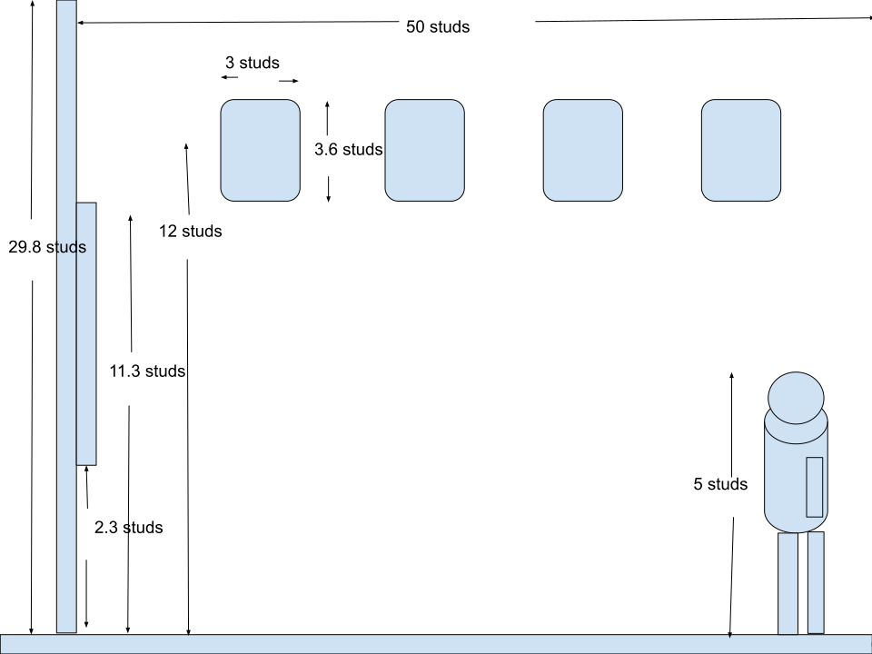
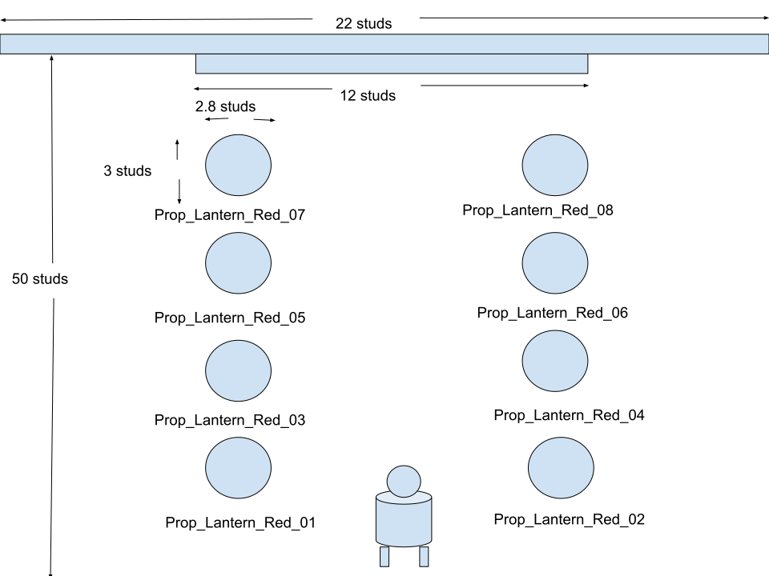

# Roblox Zone C Omoide Yokocho Area Design Spec

本ドキュメントは room-spatial-dimension-spec.md および info-board-featured-spots.md に基づき、Zone C の MainWall に位置する **InfoBoard_02_OmoideYokocho** 前地区の立体空間デザイン、立面・平面レイアウト仕様、ならびに周辺に配置する3D提灯プロップ（赤提灯オブジェクト等）の配置トランスフォームおよび動的出現・光源制御アニメーション仕様を定義する。

## 🏛️ Area Overview & Spatial Concept

InfoBoard_02_OmoideYokocho 前地区は、新宿思い出横丁のノスタルジックな居酒屋街・赤提灯カルチャーを体験・視認できる Zone C の主要展示エリアである。
壁面に備え付けられた主要観光案内板（InfoBoard_02）を中心に、案内板前の上方空間（Y = 12.0 studs）に立体的な提灯プロップ（Prop_Lantern_Red_01〜08 3D Model）を展開する。
プレイヤーが案内板の正面方向へ接近した際、進行方向および視線に沿ってペアでインタラクティブに提灯が出現（発光）し、全提灯が出揃った段階で居酒屋歓迎アテンション音（SE_Welcome_Izakaya）が再生される演出を構築し、没入感を高める設計とする。

## 📐 Elevation & Plan Layout Specifications

本エリアの立面および平面の構成・寸法仕様は、アセットとして管理されている以下の SVG 設計図面に準拠する。

### 1. 立面仕様 (Elevation Spec)
- **参照アセット**: omoideyokocho-outer-market-elevation-spec.svg (./roblox-world/assets/omoideyokocho-outer-market-elevation-spec.svg)
  
- **主要構造**:
  * **MainWall**: 高さ 30.0 studs / 厚み 2.0 studs / 木目調仕上げ
  * **InfoBoard_02_OmoideYokocho**: 
    * Wall Mount 中心高さ: Y = 7.00 studs
    * Size: 12.0, 9.0, 0.4 studs
    * 表面 Display_Surface (SurfaceGui 1024x768): 左側エリア解説文 / 右側思い出横丁ビジュアル画像
  * **Floor Placement Level**: Zone C 床面 Top Elevation Y = 0.20 studs （空中提灯プロップ設置基準面: Y = 12.00 studs）

### 2. 平面仕様 (Plan Spec)
- **参照アセット**: omoideyokocho-outer-market-plan-spec.svg (./roblox-world/assets/omoideyokocho-outer-market-plan-spec.svg)

- **レイアウト軸**:
  * InfoBoard_02 配置位置: X = 22.00 studs, Z = 105.00 studs
  * 展示プロップ群展開領域: InfoBoard_02 周辺の上空領域（Y = 12.0 studs）

## 🏮 3D Object & Prop Deployment Transform Table

InfoBoard_02 前地区の上方空間（Y = 12.0 studs）に調整・配置された 3D オブジェクト（提灯プロップ群）の座標一覧。
2個1組（ペア）の順次出現シーケンスが組まれている。

### Prop Placement Table

| Prop Name / Object ID | Item Type / Description | Position (X, Y, Z) | Orientation (Rx, Ry, Rz) | Parent Folder / Workspace Hierarchy | Sequential Step |
| :--- | :--- | :--- | :--- | :--- | :--- |
| Prop_Lantern_Red_01 | Red Lantern / 赤提灯 (ペア1) | (-74.00, 12.00, -30.00) | (0, 0, 0) | Workspace.Props.OmoideYokocho / Prop_Lantern_Red_01 | Step 1 (同時) |
| Prop_Lantern_Red_02 | Red Lantern / 赤提灯 (ペア1) | (-68.00, 12.00, -43.00) | (0, 0, 0) | Workspace.Props.OmoideYokocho / Prop_Lantern_Red_02 | Step 1 (同時) |
| Prop_Lantern_Red_03 | Red Lantern / 赤提灯 (ペア2) | (-82.00, 12.00, -34.00) | (0, 0, 0) | Workspace.Props.OmoideYokocho / Prop_Lantern_Red_03 | Step 2 (同時) |
| Prop_Lantern_Red_04 | Red Lantern / 赤提灯 (ペア2) | (-76.00, 12.00, -46.00) | (0, 0, 0) | Workspace.Props.OmoideYokocho / Prop_Lantern_Red_04 | Step 2 (同時) |
| Prop_Lantern_Red_05 | Red Lantern / 赤提灯 (ペア3) | (-89.00, 12.00, -38.00) | (0, 0, 0) | Workspace.Props.OmoideYokocho / Prop_Lantern_Red_05 | Step 3 (同時) |
| Prop_Lantern_Red_06 | Red Lantern / 赤提灯 (ペア3) | (-82.00, 12.00, -50.00) | (0, 0, 0) | Workspace.Props.OmoideYokocho / Prop_Lantern_Red_06 | Step 3 (同時) |
| Prop_Lantern_Red_07 | Red Lantern / 赤提灯 (ペア4) | (-94.00, 12.00, -41.00) | (0, 0, 0) | Workspace.Props.OmoideYokocho / Prop_Lantern_Red_07 | Step 4 (同時) |
| Prop_Lantern_Red_08 | Red Lantern / 赤提灯 (ペア4) | (-94.00, 12.00, -41.00) | (0, 0, 0) | Workspace.Props.OmoideYokocho / Prop_Lantern_Red_08 | Step 4 (同時) |

## ⚡ Dynamic Appearance & Audio System Architecture

本エリアのプロップ出現ギミックは、モバイル環境を含むマルチプレイ時のパフォーマンス最適化およびネットワーク負荷低減のため、クライアント制御（LocalScript）によって構築・実行される。

### 1. 検出およびトリガー制御 (前方・距離統合の個別判定)
- **スクリプト配置**: StarterPlayer.StarterPlayerScripts 配下に LocalScript として配置。
- **対象オブジェクト参照**: Workspace.Featured_Sightseeing_Spots_Boards.InfoBoard_02_OmoideYokocho を動的に参照。
- **感知ロジック (距離および前方判定)**: 
  * ログインしている各プレイヤー自身のキャラクター（HumanoidRootPart）と InfoBoard_02_OmoideYokocho の距離を RunService.Heartbeat で監視し、**40 studs** 以内かつ看板の正面方向であることを検知。
  * 看板の正面方向ベクトル（-boardPivot.LookVector）とプレイヤー位置との水平方向（XZ平面）の内積（Dot Product）を算出し、隣の看板への誤反応を防ぐ厳め（threshold > 0.9）の視野角制限を適用。
  * 近接時の救済措置として、看板から **15 studs 以内** に近づいた場合は角度に関わらず正面にいるとみなし、微小な揺れによる予期せぬ非表示化を防止。
- **トリガー条件**: 条件を満たしている状態（isInFront = true）で接近した際に出現シーケンスを開始し、条件外へ離れた場合は全プロップおよび内部 PointLight を非表示・消灯状態にリセットする。

### 2. ポップアップアニメーション & SE再生・光源制御メカニズム
- **初期状態管理**:
  * 通信ラグによるゲーム開始時のチラつき（瞬間表示）を防ぐため、Roblox Studio 上で全プロップのプロパティを事前に Transparency = 1（透明）かつ内部 PointLight を Enabled = false に設定。
  * スクリプト起動時の初期化関数 hideAllLanterns() により、元サイズ・CFrame データの保持および安全網としての非表示化・消灯を実行。
  * 提灯は上空（Y = 12.0 studs）に配置されているため、CanCollide（衝突判定）の切り替え処理は不要とし、制御を簡素化。
- **サウンド一括管理**: 
  * Workspace.AudioAssets フォルダ配下にポップサウンドアセット SE_Pop_Common (SoundId: rbxassetid://100517105966579) および歓迎用アセット SE_Welcome_Izakaya を配置して一括管理する。
- **浮き出るアニメーション演出 (TweenService & PointLight)**:
  * 各プロップの出現時、下方向（-1.5 studs オフセット）および縮小状態（スケール 0.2）から元の位置・サイズへ Enum.EasingStyle.Back および Enum.EasingDirection.Out を用いて約 0.35 秒間で飛び出すポップアップ補間を行う。
  * 出現と同時に Transparency = 0 に変更し、内部の PointLight を Enabled = true に切り替える（ヘルパー関数 setPropLightEnabled による自動取得・制御）。
  * 各ステップのポップアップ演出開始と同時に SE_Pop_Common の再生位置をリセット (TimePosition = 0) して「ポンッ」という効果音を連続再生する。
  * 全 8 個（4 ステップ）の提灯がすべて出現・点灯した直後に、歓迎 SE（SE_Welcome_Izakaya）を再生する。

### 3. 時間差出現シーケンス (ペア2個ずつ順次出現)
プレイヤーの動線・接近に合わせて、以下の 4 ステップ（各ステップ間隔: DELAY_TIME = 0.25 秒）で時間差出現・点灯を行う。

  Step 1: Prop_Lantern_Red_01 & Prop_Lantern_Red_02 が SE とともにポップアップ出現・点灯
  Step 2: Prop_Lantern_Red_03 & Prop_Lantern_Red_04 が SE とともにポップアップ出現・点灯
  Step 3: Prop_Lantern_Red_05 & Prop_Lantern_Red_06 が SE とともにポップアップ出現・点灯
  Step 4: Prop_Lantern_Red_07 & Prop_Lantern_Red_08 が SE とともにポップアップ出現・点灯 -> SE_Welcome_Izakaya 再生

## 📂 Service & Workspace Hierarchy Integration

思い出横丁エリアの全オブジェクト、クライアントスクリプト、およびサウンドアセットは、以下の階層構造に従って整理・格納する。

    Workspace
    ├── 🏛️ Featured_Sightseeing_Spots_Boards
    │   └── 🖼️ InfoBoard_02_OmoideYokocho
    ├── 📦 Props
    │   └── 📁 OmoideYokocho
    │       ├── Prop_Lantern_Red_01
    │       ├── Prop_Lantern_Red_02
    │       ├── Prop_Lantern_Red_03
    │       ├── Prop_Lantern_Red_04
    │       ├── Prop_Lantern_Red_05
    │       ├── Prop_Lantern_Red_06
    │       ├── Prop_Lantern_Red_07
    │       └── Prop_Lantern_Red_08
    └── 🔊 AudioAssets
        ├── 🎵 SE_Pop_Common (Sound)
        └── 🎵 SE_Welcome_Izakaya (Sound)

    StarterPlayer
    └── 📁 StarterPlayerScripts
        └── 📜 OmoideYokocho_PropController (LocalScript)

## 🔗 Related Documentation & Links

- メインインデックス: ../index.md
- 全体オブジェクト配置計画: ../object-deployment-plan.md
- 空間座標・寸法計算仕様書: ./room-spatial-dimension-spec.md
- 主要観光スポット案内板仕様書: ./info-board-featured-spots.md
- ワークスペース階層仕様書: ./workspace-hierarchy.md
