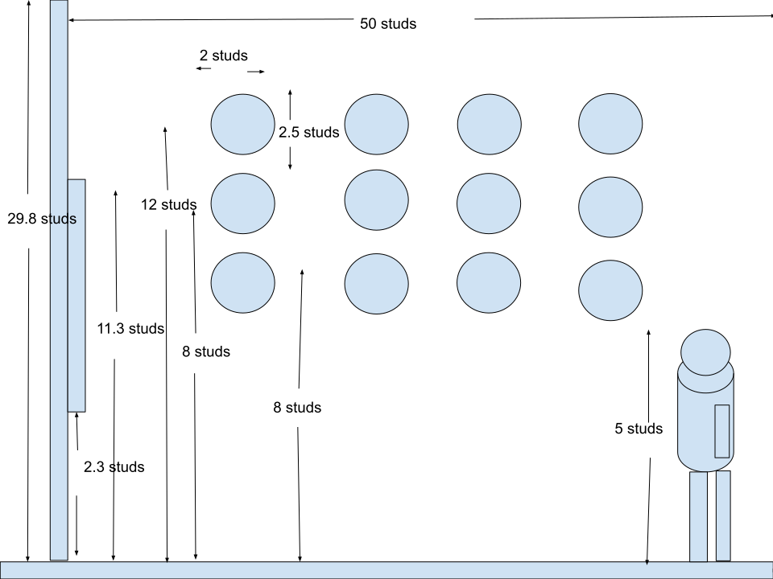
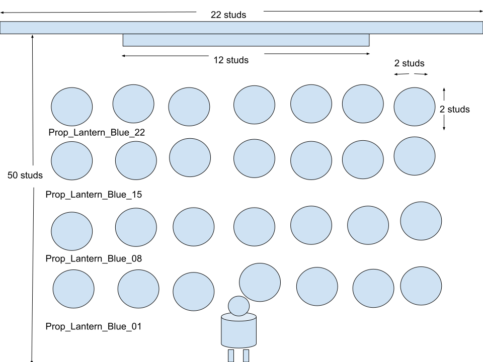

# Roblox Zone C Tokyo Central Station Area Design Spec

本ドキュメントは room-spatial-dimension-spec.md および info-board-featured-spots.md に基づき、Zone C の MainWall_03（南東側）に位置する **InfoBoard_10_TokyoStation** 前地区の立体空間デザイン、立面・平面レイアウト仕様、ならびに周辺に配置する3D青色ランタンプロップ（Prop_Lantern_Blue_01〜28、全28個）の配置トランスフォームおよび動的出現・光源制御アニメーション仕様を定義する。

## 🏛️ Area Overview & Spatial Concept

InfoBoard_10_TokyoStation 前地区は、東京中央駅周辺の洗練された都市景観や歴史ある赤れんが駅舎カルチャーを体験・視認できる Zone C の主要展示エリアである。
壁面に備え付けられた主要観光案内板（InfoBoard_10）を中心に、提灯の並びの中心から半径 22 studs 以内にプレイヤーが接近した際、グループ単位（4グループ・各7個、計28個）で順次出現・発光する演出を構築する。
各グループのポップアップ時にポップサウンド（SE_Pop_Common）が再生され、全28個の出現完了直後にアテンション音（SE_DEDEN）が再生されることで、エリア全体の没入感を高める設計とする。

## 📐 Elevation & Plan Layout Specifications

本エリアの立面および平面の構成・寸法仕様は、アセットとして管理されている以下の SVG 設計図面に準拠する。

### 1. 立面仕様 (Elevation Spec)
- **参照アセット**: tokyo-central-station-elevation-spec.svg (./roblox-world/assets/tokyo-central-station-elevation-spec.svg)

- **主要構造**:
  * **MainWall_03**: 高さ 30.0 studs / 厚み 2.0 studs / 木目調仕上げ
  * **InfoBoard_10_TokyoStation**: 
    * Wall Mount 中心高さ: Y = 7.00 studs
    * Size: 12.0, 9.0, 0.4 studs
    * 表面 Display_Surface (SurfaceGui 1024x768): 左側エリア解説文 / 右側東京中央駅ビジュアル画像
  * **Floor Placement Level**: Zone C 床面 Top Elevation Y = 0.20 studs （青色ランタンプロップ設置基準面）

### 2. 平面仕様 (Plan Spec)
- **参照アセット**: tokyo-central-station-plan-spec.svg (./roblox-world/assets/tokyo-central-station-plan-spec.svg)

- **レイアウト軸**:
  * InfoBoard_10 配置位置: X = 101.93 studs, Y = 7.00 studs, Z = 33.45 studs (MainWall_03上)
  * 展示プロップ群展開領域: InfoBoard_10 周辺および中央基準位置からの近接エリア（判定トリガー距離: 22 studs）

## 🏮 3D Object & Prop Deployment Transform Table

InfoBoard_10 前地区に調整・配置された 3D オブジェクト（青色ランタンプロップ群 01〜28）の構造とグループ分け一覧。
4つのグループ（各7個ずつ）に分かれており、順番に順次出現シーケンスが組まれている。

### Prop Placement Table (Group Summary)

| Group ID / Name | Item Type / Description | Prop Count | Parent Folder / Workspace Hierarchy | Sequential Step |
| :--- | :--- | :--- | :--- | :--- |
| **Group 1 (Prop_Lantern_Blue_01〜07)** | Blue Lantern / 青色ランタン (グループ1) | 7個 | Workspace.Props.TokyoCentralStation / Prop_Lantern_Blue_01〜07 | Step 1 (SE_Pop_Common再生) |
| **Group 2 (Prop_Lantern_Blue_08〜14)** | Blue Lantern / 青色ランタン (グループ2) | 7個 | Workspace.Props.TokyoCentralStation / Prop_Lantern_Blue_08〜14 | Step 2 (SE_Pop_Common再生) |
| **Group 3 (Prop_Lantern_Blue_15〜21)** | Blue Lantern / 青色ランタン (グループ3) | 7個 | Workspace.Props.TokyoCentralStation / Prop_Lantern_Blue_15〜21 | Step 3 (SE_Pop_Common再生) |
| **Group 4 (Prop_Lantern_Blue_22〜28)** | Blue Lantern / 青色ランタン (グループ4) | 7個 | Workspace.Props.TokyoCentralStation / Prop_Lantern_Blue_22〜28 | Step 4 (SE_Pop_Common再生 -> SE_DEDEN再生) |

## ⚡ Dynamic Appearance & Audio System Architecture

本エリアのプロップ出現ギミックは、モバイル環境を含むマルチプレイ時のパフォーマンス最適化およびネットワーク負荷低減のため、クライアント制御（LocalScript: TokyoCentralStation_PropController）によって構築・実行される。

### 1. 検出およびトリガー制御 (エリア中心基準の個別判定)
- **スクリプト配置**: StarterPlayer.StarterPlayerScripts 配下に LocalScript (TokyoCentralStation_PropController) として配置。
- **対象オブジェクト参照**: 
  * InfoBoard_10_TokyoStation (Workspace.Featured_Sightseeing_Spots_Boards.InfoBoard_10_TokyoStation)
  * プロップ格納フォルダ: Workspace.Props.TokyoCentralStation (または Workspace.AudioAssets フォールバック)
- **感知ロジック (エリア内判定)**: 
  * グループ1の先頭と末尾（Prop_Lantern_Blue_01 および Prop_Lantern_Blue_07）の位置座標の中点を基準位置として算出し、プレイヤーの HumanoidRootPart との水平方向（XZ平面）の距離を RunService.Heartbeat で監視。
  * 距離が **22 studs 以内** に接近したことを検知してトリガーを起動。離れた場合は全プロップおよび内部 PointLight を非表示・消灯状態にリセットする。

### 2. ポップアップアニメーション & SE再生・光源制御メカニズム
- **初期状態管理**:
  * 通信ラグによるゲーム開始時のチラつき（瞬間表示）を防ぐため、Roblox Studio 上で全プロップのプロパティを事前に Transparency = 1（透明）かつ内部 PointLight を Enabled = false に設定。
  * スクリプト起動時の初期化関数 hideAllLanterns() により、元サイズ・CFrame データの保持および安全網としての非表示化・消灯を実行。
- **サウンド一括管理**: 
  * Workspace.Props.AudioAssets（または Workspace.AudioAssets）フォルダ配下にポップサウンドアセット **SE_Pop_Common** およびアテンション音 **SE_DEDEN** を配置して一括管理する。
- **浮き出るアニメーション演出 (TweenService & PointLight)**:
  * 各プロップの出現時、下方向（-1.5 studs オフセット）および縮小状態（スケール 0.2）から元の位置・サイズへ Enum.EasingStyle.Back および Enum.EasingDirection.Out を用いて約 0.35 秒間で飛び出すポップアップ補間を行う。
  * 出現と同時に Transparency = 0 に変更し、内部の PointLight を Enabled = true に切り替える（ヘルパー関数 setPropLightEnabled による自動取得・制御）。
  * 各グループのポップアップ演出開始と同時に SE_Pop_Common の再生位置をリセット (TimePosition = 0) して効果音を再生する。
  * 全 28 個（4 グループ）のランタンがすべて出現・点灯した直後に、完了 SE（SE_DEDEN）を再生する。

### 3. 時間差出現シーケンス (グループごと順次出現)
プレイヤーの接近・エリアインに合わせて、以下の 4 ステップ（各ステップ間隔: DELAY_TIME = 0.25 秒）で時間差出現・点灯を行う。

  Step 1: Prop_Lantern_Blue_01〜07 が SE_Pop_Common とともにポップアップ出現・点灯
  Step 2: Prop_Lantern_Blue_08〜14 が SE_Pop_Common とともにポップアップ出現・点灯
  Step 3: Prop_Lantern_Blue_15〜21 が SE_Pop_Common とともにポップアップ出現・点灯
  Step 4: Prop_Lantern_Blue_22〜28 が SE_Pop_Common とともにポップアップ出現・点灯 -> SE_DEDEN 再生

## 📂 Service & Workspace Hierarchy Integration

東京中央駅エリアの全オブジェクト、クライアントスクリプト、およびサウンドアセットは、以下の階層構造に従って整理・格納する。

    Workspace
    ├── 🏛️ Featured_Sightseeing_Spots_Boards
    │   └── 🖼️ InfoBoard_10_TokyoStation
    ├── 📦 Props
    │   ├── 📁 TokyoCentralStation
    │   │   ├── Prop_Lantern_Blue_01 〜 07 (Group 1)
    │   │   ├── Prop_Lantern_Blue_08 〜 14 (Group 2)
    │   │   ├── Prop_Lantern_Blue_15 〜 21 (Group 3)
    │   │   └── Prop_Lantern_Blue_22 〜 28 (Group 4)
    │   └── 🔊 AudioAssets
    │       ├── 🎵 SE_Pop_Common (Sound)
    │       └── 🎵 SE_DEDEN (Sound)
    └── 🔊 AudioAssets (Fallbacks)

    StarterPlayer
    └── 📁 StarterPlayerScripts
        └── 📜 TokyoCentralStation_PropController (LocalScript)

## 🔗 Related Documentation & Links

- メインインデックス: ../index.md
- 全体オブジェクト配置計画: ../object-deployment-plan.md
- 空間座標・寸法計算仕様書: ./room-spatial-dimension-spec.md
- 主要観光スポット案内板仕様書: ./info-board-featured-spots.md
- ワークスペース階層仕様書: ./workspace-hierarchy.md
